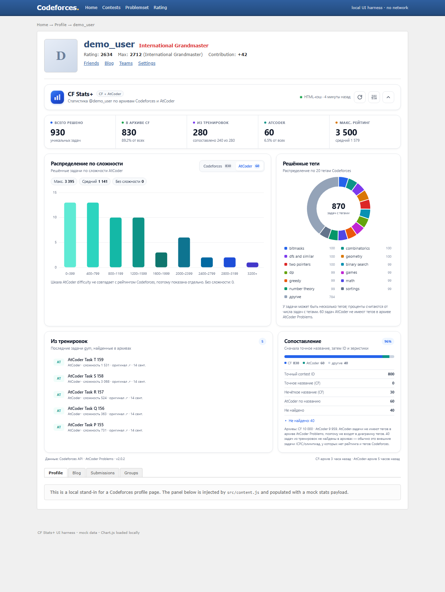

# CF Stats+ — статистика Codeforces и AtCoder в профиле

[](https://github.com/Timoface/cf-stats-extension/actions/workflows/ci.yml)
[](https://github.com/Timoface/cf-stats-extension/releases/latest)

Расширение для Chrome и Firefox (Manifest V3), которое собирает **все** решённые задачи
пользователя Codeforces — включая gym, тренировки, сборы и виртуальные контесты — и
сопоставляет их с двумя архивами:

- официальным архивом задач Codeforces (`/problemset.problems`);
- открытым архивом [AtCoder Problems](https://kenkoooo.com/atcoder/) (Kenkoooo).

Панель со статистикой автоматически встраивается в профиль `codeforces.com/profile/*`:
сводные числа, гистограмма сложности, интерактивная диаграмма тегов, последние найденные
задачи из тренировок и диагностика сопоставления.


## Что умеет

- Собирает **уникальные решённые задачи** по всей истории `user.status`, а не только по
  официальным раундам.
- Находит задачи из gym/тренировок в архиве Codeforces по `contestId + index`, точному
  названию или консервативному нечёткому совпадению.
- Дополнительно сверяет gym-задачи с архивом AtCoder по уникальным названиям.
- Схлопывает дубли: одна и та же задача, решённая в контесте и в тренировке, считается один раз.
- Понимает русские и английские названия задач: архив загружается в двух локалях, поэтому
  `Стабильные параллели` и `Stable Parallels` ведут к одной записи.
- Убирает пустой `min-height: 20em` в стандартном `.userbox .info`, из-за которого под
  информацией об аккаунте оставалось большое пустое окно до панели.
- Вставляется строго внутрь центральной колонки `#pageContent` сразу после `.userbox`:
  без `clear: both`, с `display: flow-root`, поэтому не уезжает под `float: right` сайдбар
  с таблицами лидеров и прямым эфиром. Отступ до карточки — 15 px.
- Показывает рейтинговую гистограмму CF (800…3000+), отдельную шкалу сложности AtCoder и
  donut-диаграмму тегов с интерактивной легендой.
- Аккуратно работает с API: последовательная очередь, задержка 1–5 с, экспоненциальный
  backoff, обработка 403/429/Cloudflare и сохранение cooldown между перезапусками.
- Кэширует архивы и историю посылок в `chrome.storage.local`, переживает перезапуск браузера
  и умеет отдавать устаревшие данные, если API временно недоступен.
- Работает в Chrome и Firefox, не загружает удалённый код и не отправляет данные на
  сторонние серверы.

| Desktop | Mobile |
| --- | --- |
|  |  |

Отдельная шкала AtCoder:



## Как это работает

### Источники данных

| Данные | Источник | Когда запрашивается | TTL по умолчанию |
| --- | --- | --- | --- |
| Архив задач CF | `GET /problemset.problems?locale=en` + `?locale=ru` | при первом открытии профиля | 24 ч |
| История посылок | `GET /user.status?handle=…&from=…&count=10000` | при открытии профиля | 15 мин |
| Архив AtCoder | `https://kenkoooo.com/atcoder/resources/problems.json` | при первом открытии профиля | 24 ч |
| Сложности AtCoder | `https://kenkoooo.com/atcoder/resources/problem-models.json` | вместе с архивом AtCoder | 24 ч |

**Локализация — важная деталь.** `user.status` не принимает параметр `locale`, но Codeforces
локализует `problem.name` по заголовку `Accept-Language` браузера. У русскоязычного
пользователя API может вернуть `Стабильные параллели` вместо `Stable Parallels`. Поэтому
расширение загружает problemset в двух локалях (`en` и `ru`) и прикрепляет русские названия
как алиасы к той же записи `contestId/index`. Рейтинг и теги берутся из английского архива.
Это делает то же, что ручной скрипт с обходом `/problemset/page/{n}?locale=ru`, но двумя
запросами API вместо сотен HTML-страниц.

Проверка на реальном профиле `Kseniia_Papoyan` (все имена посылок русские): без русских
алиасов из 9 gym-задач сопоставилось **0**, с алиасами — **4**. Остальные 5 отсутствуют в
CF-архиве.

История посылок читается страницами по 10 000 записей (максимум API), не более 10 страниц
за один проход. В кэш попадают только уникальные AC-посылки в компактном виде; полные
объекты посылок не сохраняются. Лимит в 100 000 посылок защищает от патологических профилей,
при достижении лимита в интерфейсе появляется предупреждение.

### Очередь, троттлинг и защита от блокировок

Все сетевые запросы выполняются в фоновом скрипте через **одну последовательную очередь**:

1. Перед запросом выдерживается `minRequestDelayMs` (по умолчанию 2100 мс) плюс случайный
   джиттер 0–250 мс.
2. При `403`, `429`, `5xx`, ошибке сети, таймауте или Cloudflare-странице включается
   экспоненциальная задержка: `3s × 2^attempt` с джиттером, но не меньше `Retry-After`.
3. Cooldown сохраняется в `chrome.storage.local` для каждого хоста отдельно. Это защищает от
   повторного «долбления» API после перезапуска service worker или открытия второй вкладки.
4. Если `Retry-After` больше 45 секунд, расширение не держит вкладку в ожидании, а сразу
   показывает понятное сообщение с временем повтора.
5. Запросы к Codeforces и AtCoder используют `credentials: 'omit'`, `cache: 'no-store'` и
   принимают только JSON. HTML-страница Cloudflare не парсится как данные.

Значение задержки можно увеличить в настройках. Уменьшать ниже 2000 мс не рекомендуется:
Codeforces просит не делать больше одного запроса в 2 секунды.

### Кэширование и устойчивость

- Архивы хранятся отдельно от истории посылок и обновляются по TTL.
- История посылок хранится для каждого handle отдельно; в кэше держится до 8 профилей,
  старые вытесняются.
- При ошибке API расширение использует **устаревшую копию**, если она есть, и показывает
  предупреждение вместо пустого экрана.
- Кнопка «Обновить» в панели игнорирует TTL и принудительно перезапрашивает данные, но
  всё равно проходит через очередь и cooldown.
- Полная очистка кэша — на странице настроек; настройки при этом сохраняются.
- Для архивов запрошено разрешение `unlimitedStorage`, чтобы большой кэш не упирался в
  стандартную квоту.

### Алгоритм сопоставления

Главный принцип: **лучше не найти задачу, чем найти неправильную**. Поэтому матчер работает
каскадом и на неоднозначностях останавливается.

#### 1. Нормализация названий

Название приводится к каноническому виду:

- снимается ведущий индекс: `A. Watermelon`, `G2) Lakeside Trail`, `Problem C — Extra Road`;
- выполняется Unicode NFKC, нижний регистр, удаление диакритики;
- апострофы удаляются (`DEGwer's` → `degwers`), `&` превращается в `and`;
- вся пунктуация становится пробелами, пробелы схлопываются;
- слова-стопперы (`the`, `problem`, `task`, `задача`, …) отбрасываются;
- названия вида `A + B` **не** теряют `A`, потому что после буквы нет индекса-пунктуатора.

Дополнительно считаются метрики:

- Dice по символьным биграммам — устойчив к опечаткам;
- покрытие токенов — учитывает добавленные квалификаторы `(Easy Version)`, `(Gym)`;
- нечёткое покрытие токенов — ловит формы `theatre`/`theater`, `watermelon`/`watermelons`;
- нормализованное расстояние Левенштейна по «склеенному» названию.

Для однословных названий действует отдельное правило: запасное совпадение допускается только
при почти идентичном написании (Levenshtein ≥ 0.90), иначе `Tables` слишком легко совпало бы
с `Table`.

#### 2. Индекс названий и O(1)-поиск

При загрузке `/problemset.problems` массив задач сохраняется в кэш в компактном виде. При
первом использовании архива (и после его обновления) `matcher.js` один раз строит несколько
`Map`:

- `exactNameMap` — `normalizeTitle(name) → [entries]`, основной индекс;
- `looseNameMap` — дополнительный ключ `name.trim().toLowerCase()`;
- `compactNameMap` — название без пробелов и пунктуации;
- `byToken`, `byPrefix`, `byTag`, `byRating` — только для запасного эвристического поиска;
- `byId` — официальный `contestId + index`.

Готовый каталог кэшируется в памяти фонового скрипта (`catalogCache`) и переиспользуется,
пока архивы не изменились. В цикле по сотням решённых задач выполняется обычный
`exactNameMap.get(...)`, а не перебор 10 000+ задач. Перебирать архив на каждую посылку
не нужно.

#### 3. Каскад поиска

1. **Точное нормализованное название — основной ключ.** Если в `exactNameMap` ровно одна
   задача, она сразу считается найденной: берутся её официальные `rating`, `tags`,
   `contestId`, `index`. Это работает для gym/тренировок, где `contestId`, индекс или
   отображаемое имя отличаются от оригинала.
2. **Дубликаты названий.** Название не всегда уникально: в текущем архиве CF около 449 групп
   с одинаковым нормализованным названием. Нельзя брать «первую попавшуюся» задачу — это
   испортит рейтинг и теги. Дубликаты разрешаются по официальному `contestId`, рейтингу и
   пересечению тегов. Совпадение только по индексу (`A`, `B`, …) больше не считается
   достаточным: индексы в тренировках часто перенумерованы. Если победителя нет — задача
   остаётся неразрешённой.
3. **Официальный ID как fallback.** Если точного названия нет, но в посылке есть
   `contestId + index`, и такая задача есть в архиве (например, название в архиве
   переименовали), используется она.
4. **Точное название в архиве AtCoder.** Для gym-посылок (`contestId >= 100000`), только для
   выразительных уникальных названий. Для `A + B`, `Watermelon` и прочих общих заголовков
   правило не применяется.
5. **Высокоточный fallback по названию/тегам.** Кандидаты собираются по общим токенам,
   префиксу, тегам и рейтингу. Обязательное условие: все значимые слова короткого названия
   должны выровняться со словами длинного, а лишние слова длинного — быть известными
   квалификаторами (`easy`, `hard`, `version`, `gym`, …). Итоговая похожесть должна быть
   ≥ **0.855**, отрыв от второго кандидата — ≥ **0.02**. Совпадающие теги дают бонус к score,
   но **не могут создать совпадение сами по себе**. Так `Credit Card Payment` не станет
   `Credit Card`, а `Tables` — `Table`.
6. Иначе задача попадает в категорию **«другая»** и не участвует в рейтинговой гистограмме,
   но может участвовать в статистике тегов, если теги пришли из посылки.

Условия задач и их хэши намеренно не скачиваются: statement-страницы тяжёлые, часто
защищены Cloudflare и дали бы ложное ощущение «точного» совпадения при другом языке или
форматировании. Авторов задач официальный API тоже не отдаёт; поэтому в fallback
используются название, теги и рейтинг, а не автор. Матчер работает только с публичными
метаданными API.

Найденная задача получает канонический ключ:

- `cf:<contestId>:<index>` — для CF-архива;
- `atcoder:<problemId>` — для AtCoder;
- `other:<нормализованное название>:<рейтинг>` — для остальных.

Дедупликация идёт по этому ключу, поэтому задача, решённая и в официальном раунде, и в
тренировке, увеличивает счётчик один раз. При этом факт решения в gym сохраняется для блока
«Из тренировок» и статистики тренировок.

#### 3. Почему не все тренировки попадают в рейтинговые графики

Это важное ограничение данных, а не ошибка очереди запросов:

- `/problemset.problems` — архив **официального** problemset Codeforces. Он не содержит
  задачи gym, которые пришли из ICPC, региональных олимпиад, AtCoder, CodeChef и т.п.
- У таких gym-задач в `user.status` часто вообще нет `rating` и `tags`. Даже если показать
  их в интерфейсе, строить по ним CF-гистограмму и donut тегов не из чего.
- На реальном профиле `Kseniia_Papoyan` все имена посылок были русскими: без RU-алиасов
  из 9 gym-задач сопоставилось **0**, с алиасами — **4**. Остальные 5 — внешние задачи,
  которых нет в CF-архиве.
- После добавления RU/EN-индекса E2E на `tourist` вырос по числу CF-совпадений
  с 2795 до **2926** при том же профиле. Это была основная причина «находит только
  официальные»: английский индекс не видел русские названия.
- Оставшиеся ненайденные gym-задачи обычно не имеют `rating` и `tags` в `user.status`.
  Даже если показать их в интерфейсе, строить по ним CF-гистограмму и donut тегов не из чего.
- Расширение честно показывает количество ненайденных gym-задач в блоке «Сопоставление» и
  не подставляет случайный рейтинг/теги. Для включения всех внешних задач нужен отдельный
  источник (архив ICPC, парсинг условий, API другого судьи), а не улучшение строкового
  сравнения.

Если конкретная задача **есть** в `/problemset.problems`, но не находится — это баг
матчера; такие случаи нужно проверять по названию и `contestId`. Ложное совпадение хуже
пропуска: оно навсегда испортит график рейтинга и тегов.

#### 4. Что считается в графиках

- **Всего решено** — число уникальных задач после дедупликации.
- **В архиве CF** — задачи, найденные в официальном архиве Codeforces.
- **Из тренировок** — уникальные задачи с `contestId >= 100000`; подпись показывает, сколько
  из них удалось сопоставить с CF или AtCoder.
- **AtCoder** — задачи, найденные только в архиве AtCoder (без CF-дубля).
- **Гистограмма Codeforces** — CF-задачи с рейтингом, а также «другие» задачи, у которых
  рейтинг известен из посылки. Задачи без рейтинга показаны отдельным чипом.
- **Шкала AtCoder** — отдельная гистограмма сложности; она **не** смешивается с рейтингом CF,
  потому что это разные шкалы.
- **Теги** — теги CF-архива и теги из посылок для «других» задач. У задач AtCoder в архиве
  AtCoder Problems тегов нет, поэтому они не входят в donut; их число показано в примечании.
- Проценты тегов считаются от числа задач, у которых есть хотя бы один тег; у одной задачи
  может быть несколько тегов.

### Почему AtCoder показан отдельной шкалой

AtCoder difficulty и рейтинг Codeforces коррелируют, но не совпадают. Прямое смешивание
вводило бы пользователя в заблуждение, поэтому расширение:

- честно показывает количество AtCoder-задач;
- рисует их сложность на отдельной вкладке;
- не подмешивает их в CF-гистограмму;
- явно указывает, что у AtCoder-задач нет тегов в используемом архиве.

Расширение **не загружает посылки с сайта AtCoder** и не требует AtCoder-аккаунта. Оно
сверяет задачи, решённые на Codeforces, с публичным архивом AtCoder — это закрывает случай,
когда задача из японского/международного контеста зеркалирована в CF gym.

## Структура проекта

```text
cf_extention/
├── manifest.json                 # Chrome MV3
├── manifest.firefox.json         # Firefox MV3 (background.scripts)
├── build.mjs                     # сборка dist/chrome + dist/firefox + zip
├── package.json
├── README.md
├── LICENSE
├── THIRD_PARTY_NOTICES.md
├── icons/
│   ├── icon16.png
│   ├── icon32.png
│   ├── icon48.png
│   └── icon128.png
├── src/
│   ├── background.js             # service worker / event page
│   ├── content.js                # внедрение панели и графиков
│   ├── content.css               # стили панели (scoped #cf-stats-plus)
│   ├── options.html
│   ├── options.css
│   ├── options.js
│   ├── lib/
│   │   ├── constants.js          # сообщения, ключи, бакеты, палитра
│   │   ├── normalize.js          # нормализация и метрики похожести
│   │   ├── matcher.js            # каскад сопоставления CF + AtCoder
│   │   ├── stats.js              # агрегация и дедупликация
│   │   ├── storage.js            # chrome.storage + кэш + LRU
│   │   ├── settings.js           # валидация настроек
│   │   └── api.js                # очередь, backoff, cooldown, загрузка
│   └── vendor/
│       └── chart.umd.min.js      # Chart.js 4.4.7, локально
├── scripts/
│   ├── make-icons.ps1
│   └── package.ps1
├── tests/
│   ├── run-tests.mjs             # unit-тесты матчера, статистики, API-хелперов
│   ├── api-queue-tests.mjs       # очередь, backoff, cooldown, stale cache
│   ├── validate-manifests.mjs    # проверка manifest'ов и путей
│   ├── ui-harness.mjs            # браузерный UI-тест + скриншоты
│   ├── make-mock-stats.mjs       # генератор mock-stats.js
│   ├── firefox-e2e.mjs           # headless Firefox через web-ext
│   ├── e2e.mjs                   # Chrome E2E с настоящим background
│   ├── lib/browser.mjs           # мини-CDP клиент для Edge/Chrome
│   ├── harness/                  # локальный макет профиля CF
│   └── e2e/profile.html          # страница для Chrome/Firefox E2E
└── docs/
    ├── screenshot-desktop.png
    ├── screenshot-atcoder.png
    ├── screenshot-mobile.png
    └── options.png
```

### Почему классические скрипты, а не ES-модули

Chrome MV3 service worker и Firefox MV3 event page по-разному загружают фон. Чтобы не
тащить сборщик и не зависеть от поддержки `background.type: "module"`:

- общие библиотеки оформлены как UMD-модули и работают и в браузере, и в Node-тестах;
- Chrome service worker вызывает `importScripts(...)` (классический worker);
- Firefox получает те же файлы списком `background.scripts` в manifest;
- content script — обычный IIFE, Chart.js подключается локальным файлом **до** него.

Никакого remote code, `eval` или `new Function` нет. CSP: `script-src 'self'`.

## Сборка

Требуется Node.js 22+ (LTS). Runtime-зависимостей нет — устанавливать
`npm install` не нужно. Node нужен только для сборки и тестов; браузерные тесты используют
встроенный WebSocket, поэтому старые версии Node не подойдут.

```bash
npm run build
```

Скрипт создаёт:

```text
dist/
├── chrome/                       # распакованное расширение для Chrome
├── firefox/                      # распакованное расширение для Firefox
├── cf-stats-plus-chrome.zip
└── cf-stats-plus-firefox.zip
```

`build.mjs` проверяет, что все файлы, на которые ссылаются manifest'ы, существуют, и
пересобирает zip через PowerShell (на Windows). На другой ОС распакуйте `dist/chrome` /
`dist/firefox` вручную.

### Готовые сборки

Их не нужно собирать локально:

- [CF Stats+ для Chrome](https://github.com/Timoface/cf-stats-extension/releases/latest/download/cf-stats-plus-chrome.zip)
- [CF Stats+ для Firefox](https://github.com/Timoface/cf-stats-extension/releases/latest/download/cf-stats-plus-firefox.zip)

Chrome-архив распаковывается в постоянную папку и загружается через **Load unpacked**.
Firefox-архив распаковывается, затем выбирается `manifest.json` в `about:debugging`.

Иконки пересоздаются скриптом `scripts/make-icons.ps1` (Windows, System.Drawing). Готовые
PNG уже лежат в `icons/`.

## Установка в Chrome (режим разработчика)

1. Соберите расширение: `npm run build` или скачайте готовый Chrome-архив из
   [Releases](https://github.com/Timoface/cf-stats-extension/releases/latest).
2. Откройте `chrome://extensions`.
3. Включите **Developer mode** (переключатель справа сверху).
4. Нажмите **Load unpacked** и выберите папку `dist/chrome` (именно её, а не корень проекта).
5. Откройте любой профиль: `https://codeforces.com/profile/<handle>`.
   Панель появится под блоком информации о пользователе и вкладками профиля.
6. После изменения исходников: `npm run build` → кнопка **Reload** на `chrome://extensions` →
   обновите вкладку Codeforces.

Для Chrome Web Store загружается готовый `dist/cf-stats-plus-chrome.zip` (manifest лежит в
корне архива).

### Если панель не появилась

- Проверьте, что открыт именно `codeforces.com/profile/...`, а не `m1.codeforces.com` с
  другим DOM (поддомены тоже поддерживаются, но layout может отличаться).
- Откройте DevTools → Console и проверьте ошибки с префиксом `[CF Stats+]`.
- Убедитесь, что расширение включено и имеет доступ к `codeforces.com`.
- Перезагрузите вкладку после Reload расширения: старый content script не может общаться с
  новым service worker.

## Установка в Firefox

Требуется Firefox 142+. В manifest включена декларация
`browser_specific_settings.gecko.data_collection_permissions` (`required: ["none"]`):
AMO требует её для новых расширений с ноября 2025 года, а поддержка ключа появилась
в Firefox 140 (142 выбрано как безопасный минимум для desktop и Android).

### Временная установка (для разработки)

1. Соберите: `npm run build` или скачайте готовый Firefox-архив из
   [Releases](https://github.com/Timoface/cf-stats-extension/releases/latest) и распакуйте его.
2. Откройте `about:debugging#/runtime/this-firefox`.
3. Нажмите **Load Temporary Add-on…**.
4. Выберите `manifest.json` в папке Firefox-сборки (`dist/firefox` после локальной сборки).
5. Откройте профиль Codeforces — панель должна появиться.

Временное дополнение удаляется при перезапуске Firefox; после изменений повторите загрузку.

### Постоянная установка

Для постоянной установки в release-сборке Firefox расширение должно быть подписано Mozilla.
Есть два пути:

- отправить `dist/cf-stats-plus-firefox.zip` на [addons.mozilla.org](https://addons.mozilla.org/developers/)
  и установить подписанный `.xpi`;
- подписать самостоятельно через `web-ext sign` (нужен аккаунт AMO):
  ```bash
  npx web-ext sign --source-dir dist/firefox --api-key "$AMO_JWT_ISSUER" --api-secret "$AMO_JWT_SECRET"
  ```
  Затем установить полученный `.xpi` через `about:addons` → шестерёнка → **Install Add-on From File**.

В `manifest.firefox.json` уже задан стабильный `browser_specific_settings.gecko.id`:
`cf-stats-plus@example.com`. Замените его на свой перед публикацией, если планируете
распространение.

Firefox использует event page (`background.scripts`), а не service worker: это официально
поддерживаемый способ для MV3 в Firefox.

## Настройки

Страница настроек открывается шестерёнкой в панели, из меню расширения или через
`chrome://extensions` → **Details** → **Extension options**.

| Параметр | По умолчанию | Диапазон | Смысл |
| --- | --- | --- | --- |
| Задержка между запросами | 2100 мс | 1000–5000 | Пауза перед каждым сетевым запросом |
| Повторов при ошибке | 4 | 1–8 | Число retry при 403/429/5xx/сети |
| TTL архивов | 24 ч | 1–168 | Срок жизни архивов CF и AtCoder |
| TTL истории посылок | 15 мин | 5–240 | Срок жизни `user.status` |
| Сверять с AtCoder | вкл. | — | Включает второй архив |
| Нечёткое сопоставление CF | вкл. | — | Fuzzy-каскад по названиям |
| Тегов на диаграмме | 12 | 5–20 | Топ тегов + сегмент «другие» |
| Задач в «Из тренировок» | 5 | 3–10 | Размер списка последних найденных |

Кнопка **Очистить кэш** удаляет архивы, историю посылок и cooldown, но не настройки.
На странице настроек также видно, сколько байт занимает кэш, какие профили сохранены и не
действует ли сейчас пауза после лимита API.


## Приватность и безопасность

- Расширение не имеет собственного сервера и не отправляет данные никуда, кроме
  `codeforces.com` и `kenkoooo.com`.
- Запрашиваются только публичные данные; cookies на API-запросы не отправляются
  (`credentials: 'omit'`).
- Локально сохраняются: архивы задач, компактный список AC-посылок, настройки, cooldown.
- В манифесте только необходимые разрешения:
  - `storage` — кэш;
  - `unlimitedStorage` — архивы и история;
  - `host_permissions` для `codeforces.com` и `kenkoooo.com` — сетевые запросы;
  - content script только на `codeforces.com/profile/*`.
- Нет `eval`, `new Function`, удалённых скриптов и inline-скриптов в extension pages.
  Chart.js лежит локально (`src/vendor/chart.umd.min.js`), что соответствует MV3 CSP.
- Данные из API вставляются в DOM через `textContent`/`createElement`, а URL проверяются по
  белому списку хостов. Это защищает от XSS через название задачи или handle.
- Handle из URL дополнительно валидируется регулярным выражением.
- Расширение не запрашивает логин, пароль, cookie или токены Codeforces/AtCoder.
- В Firefox manifest явно задекларировано `data_collection_permissions.required: ["none"]`:
  разработчик не собирает и не передаёт данные пользователя. Запросы к публичному API идут
  напрямую с вашего устройства на Codeforces/AtCoder Problems.

## Разработка и тесты

```bash
npm test                  # unit-тесты + проверка manifest'ов
npm run test:ui           # UI-тест в headless Edge/Chrome + скриншоты
npm run test:e2e          # реальный service worker + реальные CF/AtCoder API
npm run test:firefox      # headless Firefox через web-ext (опционально)
```

Что покрыто:

- **Unit-тесты** (`tests/run-tests.mjs`): нормализация названий, fuzzy-метрики, все ветки
  матчера, разрешение дублей, AtCoder-правила, дедупликация, бакеты, теги, настройки,
  компактизация API-ответов.
- **API-тесты** (`tests/api-queue-tests.mjs`): последовательность очереди, минимальный
  интервал, retry после 429/`Retry-After`, обработка `FAILED`-ответов Codeforces, Cloudflare
  403, сохранение cooldown, чтение свежего кэша и stale-fallback при падении сети.
- **Manifest-валидация** (`tests/validate-manifests.mjs`): MV3, обязательные permissions,
  CSP, наличие всех файлов, порядок загрузки Chart.js, Chrome/Firefox background, иконки,
  отсутствие remote/inline-скриптов, совпадение версий.
- **UI harness** (`tests/ui-harness.mjs`): поднимает локальный макет профиля CF, подменяет
  `chrome.runtime`, проверяет инъекцию после вкладок, 23 бакета, 9 бакетов AtCoder, 13
  сегментов доната, интерактивность легенды, обработку rate-limit ошибки, collapse,
  мобильную раскладку и отсутствие горизонтального скролла. Создаёт скриншоты в `docs/`.
- **Chrome E2E** (`tests/e2e.mjs`): собирает тестовую копию `dist/chrome` с content script на
  `127.0.0.1`, запускает headless Edge с настоящим service worker, открывает локальный
  профиль и ждёт реальные данные из Codeforces API. Дополнительно проверяет страницу
  настроек, сохранение настроек и повторную загрузку из кэша. Требует сеть и установленный
  Edge/Chrome; хэндл задаётся переменной `CFS_E2E_HANDLE` (по умолчанию `tourist`).
- **Firefox E2E** (`tests/firefox-e2e.mjs`): ставит временную копию `dist/firefox` в headless
  Firefox через `web-ext`, открывает локальный профиль и получает от страницы отчёт о
  готовой панели. Проверяет Firefox MV3 `background.scripts`, content script, сетевые
  разрешения и отрисовку графиков. Требует Firefox 142+ и сеть; `web-ext` запускается через
  `npx` (при первом запуске скачивается).

Требования для UI/E2E: установленный Microsoft Edge или Google Chrome. Путь можно задать
переменной `CFS_EDGE_PATH`. Playwright/Puppeteer не используются — тесты работают через
небольшой CDP-клиент из стандартной библиотеки Node. Для Firefox E2E путь задаётся
переменной `CFS_FIREFOX_PATH`.

### Пересборка mock-данных

```bash
node tests/make-mock-stats.mjs
```

Генерирует `tests/harness/mock-stats.js` из синтетического каталога через настоящий
`stats.js` — удобно проверять вёрстку без сети.

## Ограничения

- **AtCoder-задачи без тегов.** В AtCoder Problems нет тегов, поэтому они не попадают в
  donut; их сложность показывается отдельно.
- **Сопоставление AtCoder только по названию.** Других стабильных идентификаторов в посылке
  CF нет. Поэтому используются только уникальные выразительные названия; сомнительные
  случаи отклоняются.
- **Нечёткое сопоставление CF консервативно.** Переименования, не сохраняющие ни одного
  общего токена, не находятся. Это осознанный компромисс против ложных совпадений.
- **API-лимиты.** Codeforces может отвечать 403/429/Cloudflare. Расширение уважает лимиты,
  но при жёсткой блокировке данные могут быть недоступны; кэш и cooldown помогают.
- **Не более 100 000 посылок** за один проход (10 страниц × 10 000). Для подавляющего
  большинства профилей этого достаточно; ограничение видно в предупреждении.
- **Профили организаций/команд** могут не отдавать `user.status`; API-ошибка показывается
  в панели.
- **Gym-задачи с одинаковыми названиями** могут остаться неразрешёнными, если архив CF
  содержит несколько задач с тем же названием и нет рейтинга/тегов для разрешения.
- **AtCoder difficulty** — это модельная сложность, а не официальный рейтинг; она может
  отсутствовать, а отрицательные значения приводятся к 0 (бакет 0–399).
- **Firefox** в release-сборке требует подписи Mozilla и Firefox 142+; временная
  установка работает в актуальных версиях без подписи.

## Диагностика проблем

| Симптом | Что проверить |
| --- | --- |
| «Пользователь не найден» | Handle в URL, приватность профиля, доступность API |
| «Codeforces ограничил частоту запросов» | Не обновляйте панель часто; подождите N минут; cooldown виден в настройках |
| «Codeforces временно блокирует (Cloudflare)» | Подождите несколько минут; не помогает — очистите кэш и повторите позже |
| Панель пустая / нет графиков | DevTools Console, наличие `src/vendor/chart.umd.min.js`, перезагрузка вкладки |
| Данные устарели | Кнопка «Обновить» или очистка кэша в настройках |
| Много «других» задач | Задача действительно отсутствует в архивах или название изменено слишком сильно |
| Firefox не загружает фон | Нужен Firefox 142+; проверьте `about:debugging` и `background.scripts` |
| После обновления расширения панель не работает | Перезагрузите вкладку Codeforces (старый content script теряет связь с новым worker) |

## Лицензии и благодарности

- Код расширения — MIT, см. [LICENSE](LICENSE).
- [Chart.js](https://www.chartjs.org/) 4.4.7 — MIT, локальный UMD-бандл.
- [AtCoder Problems](https://kenkoooo.com/atcoder/) (Kenkoooo) — открытый архив и модели
  сложности; проект распространяется под MIT.
- Данные Codeforces и AtCoder принадлежат соответствующим платформам и авторам задач.
  Расширение неофициальное и не аффилировано с Codeforces или AtCoder.

Подробнее — в [THIRD_PARTY_NOTICES.md](THIRD_PARTY_NOTICES.md).
